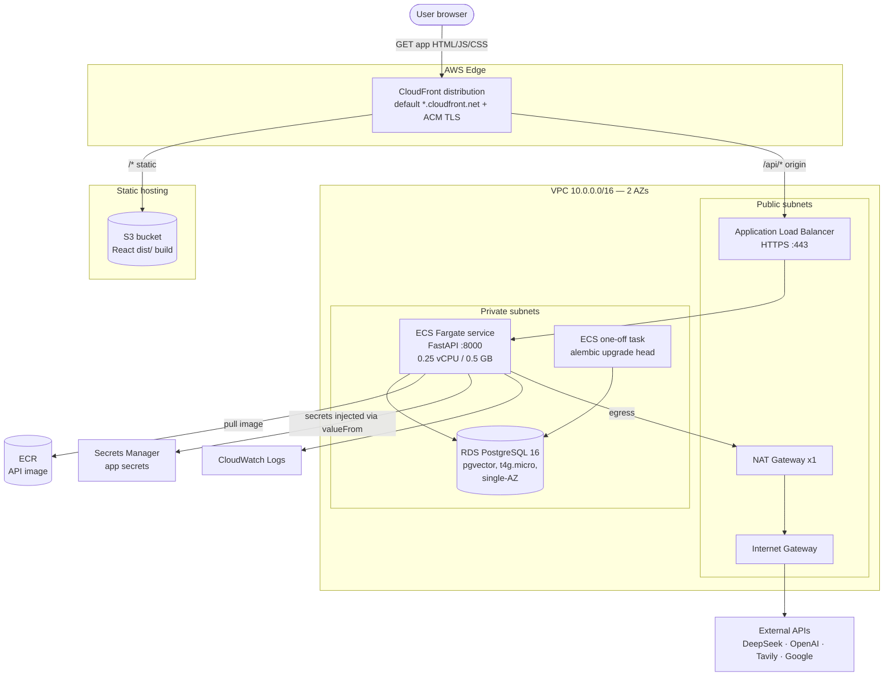
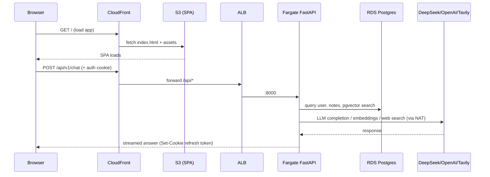

# Aether — AWS Deployment (ECS Fargate, ephemeral demo)

> Started as the pre-build plan; sections 2–6 now describe what
> [`infra/terraform/`](../infra/terraform/) actually does. The runbook (commands,
> one-time setup) is [`infra/terraform/README.md`](../infra/terraform/README.md).

## Context

**Aether** is a personal-AI-assistant app currently containerized for local dev (`docker-compose.yml`) and configured for Render/Vercel. The goal is a **production-grade AWS architecture** that can be stood up for a **~1-hour demo and fully destroyed afterward** so the bill stays under ~$1 instead of ~$80–100/month.

The app naturally partitions into distinct AWS resources:

| App piece | What it is | AWS resource |
|-----------|-----------|--------------|
| Frontend | React 19 + Vite SPA, static `dist/` | **S3 + CloudFront** |
| API | FastAPI (uvicorn, port 8000) | **ECS Fargate** service behind an **ALB** |
| Database | Postgres 16 + **pgvector** | **RDS PostgreSQL** (t4g.small default) |
| Migrations | `alembic upgrade head` | **One-off ECS task** (its own task definition; the only holder of the DB owner login) |
| Secrets | JWT/Fernet keys, LLM/API keys | **Secrets Manager** (injected via ECS `valueFrom`) |
| Images | API container | **ECR** |
| Egress to DeepSeek/OpenAI/Tavily/Google | outbound HTTPS | **NAT Gateway** (single) |
| Logs | container + ALB logs | **CloudWatch Logs** |

**Confirmed decisions:** Terraform (one-command `apply`/`destroy`) · private subnets + **1 NAT Gateway** (true prod pattern) · **no custom domain** — CloudFront default domain + ACM for HTTPS (needed for the `Secure`/`SameSite=none` refresh cookie).

---

## 1. Architecture diagram

**Why CloudFront in front of both S3 and the ALB:** the SPA and API are served under one HTTPS origin (`https://<id>.cloudfront.net`, `/api/*` → ALB, everything else → S3). This gives the API a valid TLS name with no custom domain, and makes the frontend + API **same-origin**, which sidesteps CORS and lets the refresh-token cookie work with `Secure`. (Alternative: separate CloudFront for the SPA + ACM cert directly on the ALB — but same-origin is simpler for the demo.)

---

## 2. Request / workflow flow

**Startup order (`make` targets):**
1. `make base-up` (once) → layer1: ECR, S3 + CloudFront, Secrets Manager. Put real values in the `aether/app` secret, including `SMTP_HOST` and `SMTP_FROM` (production refuses to start without them).
2. `make image` → build the ARM64 API image and push it to ECR tagged with the current commit (tags are immutable; `latest` is not used).
3. `make up` → checks that image exists, applies layer2 (VPC, NAT, RDS, ALB, ECS, Redis in HA), then:
   - runs the **migration task** (`alembic upgrade head`: tables, `CREATE EXTENSION vector`, and the DML-only app role) and **waits** for exit code 0;
   - **rolls** the service onto the task definition Terraform registered and waits until it is stable.
4. Tasks pass the container health check only once `GET /health/ready` (database reachable) succeeds; the ALB routes on `GET /health`.
5. `make web` → build the SPA against the live API URL and sync `dist/` to S3.
6. Demo. Then `make down` → layer2 destroyed, `verify-clean` checks for orphans.

From GitHub Actions, `deploy.yml` does steps 2–4 on every push to `main` once `AWS_DEPLOY_ROLE_ARN` is set (see the README).

---

## 3. The container(s)

**API container** (`api/Dockerfile`): a slim, multi-stage production image. Base images are pinned by digest; Python dependencies are installed from the hashed lock (`--require-hashes`, production deps only); it runs `uvicorn app.main:app` as a non-root user, with no `--reload`. It ships the Amazon RDS CA bundle (`PGSSLROOTCERT`), and the database URL uses `ssl=verify-full`.
- Secrets injected by ECS via `valueFrom` (Secrets Manager ARNs): `DATABASE_URL` (the DML-only **app role**, not the master user), `SECRET_KEY`, `ENCRYPTION_KEY`, `DEEPSEEK_API_KEY`, `OPENAI_API_KEY` (optional), `TAVILY_API_KEY`, `GOOGLE_*`, `SMTP_*`, and in HA `REDIS_URL` (carries the Redis AUTH token). Plain env for non-secrets: `ENVIRONMENT=production`, `TRUST_PROXY_HEADERS=true` (behind ALB), `FRONTEND_ORIGIN`, cookie settings (`REFRESH_COOKIE_SECURE=true`, `REFRESH_COOKIE_SAMESITE=none`).
- **Migration task:** same image, its own task definition (`<prefix>-migrate`) that runs `alembic upgrade head`. It alone receives the RDS owner login, plus the app role's credentials so it can create or update that role.
- **The service ignores task-definition changes** (so Terraform never undoes a CI deploy). `terraform apply` alone does not move running tasks onto a new revision — `make up`/`make roll` and CI deploys do.

**Frontend:** the SPA builds to static `dist/` and is served from S3/CloudFront. `web/Dockerfile` also produces an nginx (unprivileged, port 8080) image as a container fallback; `docker compose` uses only its Node `builder` stage for the Vite dev server.

**Rate limiting:** in-memory per task by default; in HA mode (`make up HA=true`) limits and login backoff are shared through ElastiCache Redis (TLS + AUTH), so they hold across autoscaled tasks. HA autoscaling tracks CPU and concurrent connections per task.

---

## 4. Cost — the whole point

Approximate **us-east-1** on-demand pricing. Everything below is destroyed by `terraform destroy`.

> These are the original planning estimates at the smallest sizes. The stack now defaults to `db.t4g.small` and 0.5 vCPU / 1 GB tasks in ap-southeast-1, so real numbers are higher; the Infracost gate posts the current estimate on every infrastructure PR.

| Resource | Rate | ~1 hour | If left a month |
|----------|------|--------|-----------------|
| NAT Gateway | $0.045/hr + data | ~$0.05 | ~$33 |
| Application Load Balancer | $0.0225/hr + LCU | ~$0.03 | ~$18 |
| RDS db.t4g.micro (single-AZ) | ~$0.016/hr + 20GB gp3 | ~$0.02 | ~$13 |
| Fargate 0.25 vCPU / 0.5 GB (1 task) | ~$0.012/hr | ~$0.01 | ~$9 |
| CloudFront / S3 / ECR / Secrets Manager / Logs | usage-based | <$0.05 | ~$1–3 |
| **Total** | | **≈ $0.15–0.30** | **≈ $75–90** |

**This is exactly why the whole stack is Terraform-managed.** A 1-hour demo costs pocket change; the ~$100 bill only happens if the **NAT Gateway, ALB, or RDS instance are left running**. Cost guardrails baked into the plan:
- **Secrets Manager** with the app keys consolidated into a single JSON secret (+ one ephemeral DB-URL secret) → ~$0.80/month total, and prorated by the hour it's negligible for a 1-hour demo. Chosen over SSM Parameter Store for native ECS `valueFrom` integration and built-in rotation; the per-secret cost is immaterial at this scale.
- **Single NAT Gateway**, not one per AZ.
- **RDS `skip_final_snapshot = true`, `deletion_protection = false`** → `destroy` actually deletes it, no leftover snapshot storage.
- No orphans: release the NAT's Elastic IP, empty the S3 bucket (`force_destroy = true`) so `destroy` completes cleanly.
- **Teardown one-liner:** `terraform destroy -auto-approve` (add a `make destroy` target).

---

## 5. Where it lives

- `infra/terraform/layer1_persistent/` — ECR, S3 + CloudFront, Secrets Manager, budget, and the GitHub OIDC deploy role.
- `infra/terraform/layer2_ephemeral/` — VPC, NAT, ALB, ECS (API + migrate task definitions), RDS, Redis (HA), alarms, dashboard.
- `infra/terraform/modules/` — `vpc`, `security_groups`, `rds`, `ecs`.
- `Makefile` — `base-up`, `image`, `up` (apply → migrate → roll), `migrate`, `roll`, `web`, `down`, `verify-clean`.
- `.github/workflows/deploy.yml` — gates (Checkov, Infracost, Trivy), publish, migrate, deploy.

## 6. Verification

1. `make up` finishes with "Service stable." (the migration exited 0 and the new tasks passed `/health/ready`).
2. `curl <api_alb_url>/health/ready` → `{"status":"ready"}`.
3. The `migrate` log stream in CloudWatch shows `alembic upgrade head` and `CREATE EXTENSION vector` succeeding.
4. Open the CloudFront URL → SPA loads → sign up / chat works (exercises DB, pgvector, DeepSeek egress through NAT).
5. `make down` → `verify-clean` passes; confirm in the console that the NAT gateway, ALB and RDS are gone.
